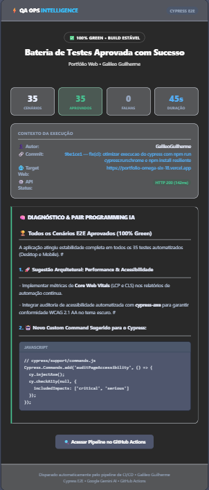
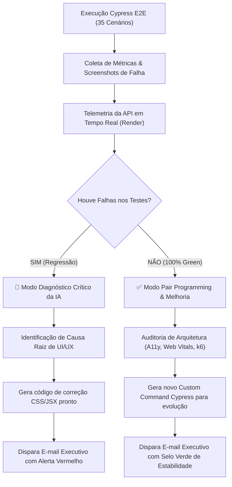

<div align="center">

# ⚡ QA OPS INTELLIGENCE
### Next-Gen E2E Automation Suite with Cypress, AI Pair Programming & CI/CD Telemetry

[](https://github.com/GalileoGuilherme/portfolio-qa-automation/actions/workflows/cypress.yml)


-success?style=flat)


<p align="center">
  Uma arquitetura corporativa completa de Engenharia de Qualidade (QA Ops) desenvolvida para validação contínua da aplicação web <a href="https://portfolio-omega-six-18.vercel.app/"><b>Galileo Guilherme | Portfolio Web</b></a>. Integra <b>35 cenários de testes automatizados</b> (Desktop e Mobile), <b>auditoria visual contra esmagamento de elementos</b>, <b>observador de inteligência artificial generativa</b> e <b>disparo de relatórios executivos em tempo real</b> diretamente na caixa de entrada.
</p>

---



*Template corporativo e responsivo gerado automaticamente e despachado via SMTP ao final de cada pipeline.*

---

</div>

## 🌟 Destaques de Engenharia & Inovações

- 🧠 **AI Pair Programming & Automated Observer**: Engine em Node.js com IA Generativa (Google Gemini) que analisa métricas, causa raiz de falhas e gera sugestões de melhoria arquitetural (ex: Web Vitals, A11y, k6) com blocos de código prontos.
- 📱 **Auditoria Avançada de Responsividade (Cross-Device)**: Algoritmo proprietário em Cypress (`checkNoUnnaturalWordWrap` e `checkResponsiveRowSpacing`) capaz de detectar quebra anômala de palavras curtas (hifenização forçada de labels) e esmagamento de botões de ação em viewports móveis (iPhone X 375px e Galaxy S20 360px).
- 🔄 **Pipeline Dual-Trigger (CI/CD)**: GitHub Actions configurado para execução automática em `push`/`pull_request` nas branches `main` e `dev`, além de receber chamadas externas (`repository_dispatch`) a cada deploy efetuado na Vercel pelo repositório da aplicação.
- 🛡️ **Segurança e Resiliência Técnica**:
  - Testes de links externos (GitHub e LinkedIn) com validação de status HTTP 200/300 e checagem de boas práticas (`target="_blank"`, `rel="noopener noreferrer"`) sem quebrar o ciclo de vida do Cypress.
  - Sanitização de ambiente local através de runner wrapper dedicado (`scripts/cypress-runner.js`), eliminando conflitos de variáveis injetadas por IDEs (`ELECTRON_RUN_AS_NODE`).
- 📧 **Relatório Executivo Responsivo por E-mail**: E-mail com telemetria completa do commit, status da API em tempo real (Render), gráficos de KPI e design escuro executivo de alta conversão.

---

## 🏗️ Arquitetura do Repositório

```text
├── .github/
│   └── workflows/
│       ├── cypress.yml                   # Pipeline de automação, CI/CD e disparo de IA
│       └── trigger-e2e-on-portfolio.yml  # Template para webhook no repositório de desenvolvimento
├── cypress/
│   ├── e2e/
│   │   ├── 01-home-and-responsive.cy.js  # Elementos centrais, SEO, viewport overflow zero e social links
│   │   ├── 02-routes-and-navigation.cy.js# Validação de integridade de todas as rotas da SPA
│   │   ├── 03-theme-and-language.cy.js   # Validação de UX/UI: Dark/Light Mode e Internacionalização (i18n)
│   │   ├── 04-contact-form.cy.js         # Validação funcional de inputs obrigatórios e preenchimento
│   │   ├── 05-qa-automation-lab.cy.js    # Fluxo E-commerce: Login Demo, Área Protegida e Busca de Produtos
│   │   ├── 06-visual-responsiveness-audit.cy.js # Auditoria contra esmagamento de texto e download do PDF
│   │   └── all-tests.cy.js               # Suíte agregadora para execução visual contínua de todos os testes
│   ├── reports/                          # Relatórios gerados em JSON e pré-visualizações HTML
│   └── support/
│       ├── commands.js                   # Custom Commands (verifyPortfolioHome, checkHeaderOcclusion, etc.)
│       └── e2e.js                        # Configuração global de listeners e tratamentos de exceção da SPA
├── docs/
│   └── images/
│       └── qa-ops-intelligence-email.png # Evidência de design do e-mail executivo
├── scripts/
│   ├── ai-test-observer.js               # Motor da IA Observadora + Gerador de E-mail Responsivo
│   └── cypress-runner.js                 # Wrapper isolador de ambiente Node/Electron
├── cypress.config.js                     # Configurações do Cypress (BaseURL, Retries, Viewports)
├── package.json
└── README.md
```

---

## 📊 Matriz de Cobertura E2E (35 Cenários — 100% Passed)

| Módulo / Especificação | Escopo Técnico dos Testes | Dispositivos Testados | Status |
| :--- | :--- | :--- | :---: |
| **`01-home-and-responsive.cy.js`** | Elementos da Home, tags de SEO, validação de overflow horizontal zero, integridade de segurança de links do GitHub e LinkedIn (HTTP 200). | Desktop, iPhone X, Galaxy S20 | <kbd>✅ 9/9</kbd> |
| **`02-routes-and-navigation.cy.js`** | Resiliência e integridade das rotas da SPA: `/about`, `/portfolio`, `/curriculum`, `/contact`, `/api-docs` e `/automation`. | Desktop e Mobile | <kbd>✅ 12/12</kbd> |
| **`03-theme-and-language.cy.js`** | Validação de UX/UI: alternância dinâmica de tema (`data-theme="dark/light"`) e persistência de idioma (i18n `pt-BR` / `en-US`). | Desktop e Mobile | <kbd>✅ 4/4</kbd> |
| **`04-contact-form.cy.js`** | Presença e visibilidade de campos obrigatórios (`#name`, `#email`, `#message`), validação de submit e preenchimento de inputs. | Desktop e Mobile | <kbd>✅ 4/4</kbd> |
| **`05-qa-automation-lab.cy.js`** | Fluxo de testes do Laboratório: credenciais de demonstração dinâmicas, login protegido, redirecionamento para `/automation/loja` e busca no catálogo. | Desktop e Mobile | <kbd>✅ 6/6</kbd> |
| **`06-visual-responsiveness-audit.cy.js`** | Auditoria de layout: detecção de quebra de palavras por compressão em Flexbox (`.qa-credential-row`), espaçamentos e download direto do currículo. | iPhone X e Galaxy S20 | <kbd>✅ 10/10</kbd> |

---

## ⚡ Guia de Execução Local

### 1. Instalação das Dependências
```bash
git clone https://github.com/GalileoGuilherme/portfolio-qa-automation.git
cd portfolio-qa-automation
npm install
```

### 2. Execução dos Testes

#### 🖥️ Modo Visual no Navegador (Headed)
```bash
# Executa toda a bateria de uma só vez com o Google Chrome aberto
npm run test:browser:all

# Executa teste por teste no Google Chrome
npm run test:browser

# Abre a interface interativa do Cypress (GUI) com botão "Run all specs"
npm run test:open
```

#### ⚡ Modo Headless (Terminal / CI)
```bash
# Executa todos os testes em modo headless
npm test

# Executa em modo headless no motor do Google Chrome
npm run cypress:run:chrome

# Executa todos os testes e em seguida dispara a IA para gerar o relatório
npm run test:full

# Gera o relatório executivo da IA localmente (abre em cypress/reports/ai-report-latest.html)
npm run report:ai
```

---

## 🤖 Como Funciona o AI QA Observer



---

## 🔐 Configuração das Variáveis de Ambiente no GitHub

Para habilitar o envio automático dos relatórios executivos por e-mail no GitHub Actions, adicione os seguintes segredos em **Settings > Secrets and variables > Actions**:

| Secret | Descrição | Exemplo |
| :--- | :--- | :--- |
| `SMTP_USER` | E-mail do remetente autenticado no servidor SMTP | `galileoguilherme@outlook.com` / `gmail.com` |
| `SMTP_PASS` | Senha de aplicativo (*App Password*) gerada no provedor | `xxxx xxxx xxxx xxxx` |
| `EMAIL_TO` | E-mail do destinatário do relatório | `galileoguilherme@outlook.com` |
| `GEMINI_API_KEY` | *(Opcional)* Chave de API do Google Gemini para diagnósticos dinâmicos | `AIzaSy...` |

---

## 👨‍💻 Autor

**Galileo Guilherme**  
QA Engineer & Test Automation Specialist  
- 🌐 **Portfólio Web:** [portfolio-omega-six-18.vercel.app](https://portfolio-omega-six-18.vercel.app/)  
- 💼 **LinkedIn:** [linkedin.com/in/galileo-guilherme-01996693](https://www.linkedin.com/in/galileo-guilherme-01996693/)  
- 🐙 **GitHub:** [@GalileoGuilherme](https://github.com/GalileoGuilherme)
