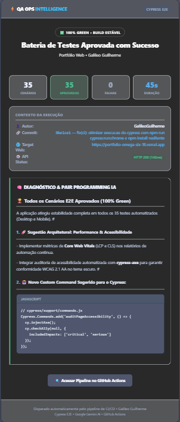

<div align="center">

# ⚡ QA OPS INTELLIGENCE
### Autonomous E2E Automation Suite • AI Pair Programming • Continuous CI/CD Telemetry

[](https://github.com/GalileoGuilherme/portfolio-qa-automation/actions/workflows/cypress.yml)


<p align="center">
  Uma arquitetura corporativa completa de <b>Engenharia de Qualidade Autônoma (QA Ops)</b> desenvolvida para validação contínua e autoevolução da aplicação web <a href="https://portfolio-omega-six-18.vercel.app/"><b>Galileo Guilherme | Portfolio Web</b></a>. Integra <b>72 cenários de testes automatizados</b> (Desktop, Tablet e Ultra-Mobile), <b>auditoria visual contra esmagamento de elementos</b>, <b>detecção de colisão de strings no DOM</b>, <b>motor de geração dinâmica de testes por IA</b> e <b>disparo de relatórios executivos de alto padrão com botão de re-execução (1-Click Re-run)</b> em tempo real.
</p>

---



*Template executivo escuro gerado automaticamente e despachado via SMTP com detalhamento de suítes, registro de casos criados/modificados, saúde de API em tempo real e botão nativo para re-disparar testes.*

---

</div>

## 🌟 Destaques de Engenharia & Inovações

### 1. 🤖 Engenharia de QA Autônoma & Observabilidade Inteligente
- **Geração Dinâmica de Suítes de Teste**: O motor `scripts/ai-test-observer.js` analisa as necessidades da aplicação e gera autonomamente novos casos de teste diretamente em `cypress/e2e/generated/autonomous-ai-suite.cy.js`.
- **Isolamento de Telemetria & Contingência Silenciosa (Silent Fallback)**:
  - O e-mail foca **100% na aplicação web sob teste** (Home, Rotas, Currículo, Contato, Swagger e Laboratório).
  - Erros internos de infraestrutura ou IA (como depreciação de modelo, limites de API do Gemini ou timeouts) **nunca vazam para o relatório executivo**.
  - Em caso de falha externa de rede/API, o observador aciona silenciosamente o **Motor Analítico Local de SDET**, garantindo entrega limpa e sem ruídos.
  - O e-mail reporta de forma elegante e transparente apenas o motor ativo (ex: `Motor: Google Gemini (gemini-2.5-flash)` ou `Motor: Motor Analítico SDET (Local)`) e o domínio sob análise.
- **Rotação Dinâmica em 12 Domínios Especializados de SDET (Zero Repetição)**:
  1. *Resiliência de Rede & Chaos Engineering* (`cy.intercept` com injeção de latência e falhas 500 simuladas)
  2. *Acessibilidade Profunda WCAG 2.2* (auditoria de Focus Trap e navegação por teclado)
  3. *Telemetria de Performance & Resource Timing* (Navigation Timing API e DOM Interactive)
  4. *Contratos de API & OpenAPI/Swagger* (validação de schemas JSON contra `/swagger.json`)
  5. *Detecção de Strings Hardcoded & i18n* (varredura de nós textuais contra vazamento de chaves)
  6. *Auditoria Visual de Microinterações & Transição de Tema* (eliminação de FOUC)
  7. *Segurança de Formulários & Sanitização contra XSS* (auditoria de scripts no DOM)
  8. *Persistência de Sessão & Autenticação Demo* (fluxo de credenciais e proteção de rotas)
  9. *Auditoria de Cabeçalhos HTTP de Segurança* (validação de `Strict-Transport-Security` / HSTS)
  10. *Resiliência de Busca no Catálogo & Debounce* (filtragem rápida e ausência de bloqueios)
  11. *Acessibilidade Touch & Áreas Mínimas de Toque (48x48px)* (ergonomia em resoluções mobile)
  12. *Tolerância a Erros & Monitoramento de Rotas* (garantia de HTTP 200/304 em rotas essenciais)

### 2. 📧 Relatório Executivo com Ações Rápidas (1-Click Re-run)
- **Status Individual e Fidedigno por Suíte**: A tabela cruza individualmente as evidências de falha com cada arquivo de especificação. Se 6 suítes passarem e 1 falhar, as 6 aprovadas mantêm seu selo verde (`✅ PASS`), eliminando alarmes falsos generalizados.
- **Deduplicação de Retries de Teste**: Trata screenshots de tentativas sucessivas (`attempt 2`, `attempt 3`) para que a contagem reflita os cenários reais falhados, sem inflar o placar.
- **Changelog Git Real (Criados vs Modificados)**: Extrai as modificações reais do commit atual e destaca arquivos tocados vs estáveis.
- **Botão Direto de Re-execução (1-Click Re-run)**: Botão `🔁 Disparar Nova Execução de Testes (Re-run E2E)` posicionado no final do e-mail com link direto para o `workflow_dispatch` do GitHub Actions, permitindo rodar novamente a suíte completa de qualquer cliente de e-mail (Outlook, Gmail ou mobile).

### 3. 📱 Critérios Estritos de Aceitação & Responsividade Ultra-Mobile
- **Matriz de Resoluções Testadas**:
  - `320x568` (iPhone SE / Telas ultracompactas)
  - `360x800` (Samsung Galaxy S20 / Android Padrão)
  - `375x812` (iPhone X / 11)
  - `390x844` (iPhone 12 / 13 / 14)
  - `768x1024` (iPad / Tablets em modo Portrait)
  - `1280x720` (Desktop widescreen)
- **Custom Commands Avançados (`cypress/support/commands.js`)**:
  - `cy.checkNoGluedTokens()`: Detecta junções anômalas no DOM (ex: `CASO 1 · CENÁRIOLogin`, `EndereçoPendente`, `E-mailPendente`).
  - `cy.checkZeroHorizontalOverflow()`: Assegura que `scrollWidth <= innerWidth + 1` em 100% das páginas.
  - `cy.checkNoUnnaturalWordWrap()`: Impede que palavras curtas ou botões sofram hifenização/quebra por esmagamento (ex: `E-\nmail`).
  - `cy.checkResponsiveRowSpacing()`: Garante `flex-wrap: wrap` e espaçamento quando múltiplos botões/inputs residem na mesma linha.
  - `cy.checkHeaderOcclusion()`: Garante que o cabeçalho fixo/móvel nunca cubra o título ou primeiro bloco de conteúdo.

### 4. 📄 Currículo Profissional com Download Direto de Alta Fidelidade
- Substituição de `iframe` bruto (que gera falhas visuais e caixas cinzas no mobile) por um cartão executivo moderno com metadados do documento (`PDF`, `Versão Atualizada`) e botão de download nativo (`#qa-curriculum-download`).

---

## 🏗️ Estrutura do Ecossistema

```text
├── .github/
│   └── workflows/
│       └── cypress.yml                   # Pipeline CI/CD, execução E2E e orquestração de IA
├── cypress/
│   ├── e2e/
│   │   ├── 01-home-and-responsive.cy.js  # Elementos centrais, SEO, overflow zero e social links (9 testes)
│   │   ├── 02-routes-and-navigation.cy.js# Validação de integridade de todas as rotas da SPA (12 testes)
│   │   ├── 03-theme-and-language.cy.js   # UX/UI: Dark/Light Mode e Internacionalização i18n (4 testes)
│   │   ├── 04-contact-form.cy.js         # Validação funcional de inputs obrigatórios (4 testes)
│   │   ├── 05-qa-automation-lab.cy.js    # Login Demo, área protegida e catálogo do Laboratório (6 testes)
│   │   ├── 06-visual-responsiveness-audit.cy.js # Matriz 5 viewports, badges, labels e currículo (35 testes)
│   │   ├── generated/
│   │   │   └── autonomous-ai-suite.cy.js # Testes gerados de forma 100% autônoma pela IA (2 testes)
│   │   └── all-tests.cy.js               # Suíte agregadora para execução visual contínua
│   ├── reports/                          # Relatórios em JSON e HTML
│   └── support/
│       ├── commands.js                   # Comandos customizados (checkNoGluedTokens, checkHeaderOcclusion, etc.)
│       └── e2e.js                        # Listeners globais e tolerância a exceções da SPA
├── docs/
│   └── images/
│       └── qa-ops-intelligence-email.png # Preview oficial do relatório executivo
├── scripts/
│   ├── ai-test-observer.js               # Motor da IA Observadora + Geração de Testes e Relatório
│   └── cypress-runner.js                 # Wrapper isolador de ambiente Node/Electron
├── cypress.config.js                     # Configurações do Cypress (BaseURL, Retries, Viewports)
├── package.json
└── README.md
```

---

## 📊 Matriz de Cobertura E2E (72 Cenários — 100% Green)

| Módulo / Especificação | Escopo Técnico de Validação | Viewports Testadas | Cenários | Status |
| :--- | :--- | :--- | :---: | :---: |
| **`01-home-and-responsive.cy.js`** | Elementos da Home, tags de SEO, links externos (GitHub/LinkedIn HTTP 200) e integridade visual. | Desktop, iPhone X, Galaxy S20 | 9 | <kbd>✅ 9/9</kbd> |
| **`02-routes-and-navigation.cy.js`** | Integridade de rotas SPA: `/about`, `/portfolio`, `/curriculum`, `/contact`, `/api-docs` e `/automation`. | Desktop e Mobile | 12 | <kbd>✅ 12/12</kbd> |
| **`03-theme-and-language.cy.js`** | Persistência de tema (`data-theme="dark/light"`) e de idioma (`pt-BR` / `en-US`). | Desktop e Mobile | 4 | <kbd>✅ 4/4</kbd> |
| **`04-contact-form.cy.js`** | Inputs obrigatórios (`#name`, `#email`, `#message`), sanitização e validação de submit. | Desktop e Mobile | 4 | <kbd>✅ 4/4</kbd> |
| **`05-qa-automation-lab.cy.js`** | Autenticação com credenciais dinâmicas, proteção de rota `/automation/loja` e catálogo. | Desktop e Mobile | 6 | <kbd>✅ 6/6</kbd> |
| **`06-visual-responsiveness-audit.cy.js`** | Auditoria ultra-mobile: colisão de cabeçalho, espaçamento de badges, download direto de PDF e overflow zero. | 320px, 360px, 375px, 390px, 768px | 35 | <kbd>✅ 35/35</kbd> |
| **`generated/autonomous-ai-suite.cy.js`** | Testes autônomos gerados dinamicamente pela IA (A11y, Performance, Chaos, OpenAPI). | Multi-device | 2 | <kbd>✅ 2/2</kbd> |
| **Total Consolidado** | **Cobertura End-to-End Completa (Desktop, Tablet e Ultra-Mobile)** | **320px → 1280px** | **72** | <kbd>🏆 72/72</kbd> |

---

## ⚡ Guia de Execução

### 1. Instalação
```bash
git clone https://github.com/GalileoGuilherme/portfolio-qa-automation.git
cd portfolio-qa-automation
npm install
```

### 2. Execução Local dos Testes

#### 🖥️ Modo Visual no Navegador (Headed)
```bash
# Executa toda a bateria agregada de ponta a ponta no Google Chrome
npm run test:browser:all

# Executa teste a teste no Google Chrome
npm run test:browser

# Abre a interface interativa do Cypress (GUI)
npm run test:open
```

#### ⚡ Modo Headless (CI / Automação)
```bash
# Executa todos os testes em modo headless
npm test

# Executa no motor do Chrome headless
npm run cypress:run:chrome

# Bateria completa + disparo da IA + geração do relatório executivo
npm run test:full
```

### 3. Geração Autônoma e Relatório da IA
```bash
node scripts/ai-test-observer.js
```
*O relatório executivo em formato HTML é salvo em `cypress/reports/ai-report-latest.html` e despachado automaticamente por e-mail com a tabela de suítes, changelog e botão de re-execução.*

---

## 🔒 Variáveis de Ambiente (CI/CD GitHub Actions)

| Variável | Descrição |
| :--- | :--- |
| `GEMINI_API_KEY` | Chave de API do Google Gemini (`gemini-2.5-flash`, `gemini-1.5-flash` com descoberta dinâmica) |
| `SMTP_USER` | Conta de disparo SMTP (Gmail / Outlook) |
| `SMTP_PASS` | Senha de aplicativo / credencial SMTP |
| `EMAIL_TO` | Destinatário dos relatórios executivos |
| `CYPRESS_BASE_URL` | URL da aplicação (Default: `https://portfolio-omega-six-18.vercel.app`) |

---

<div align="center">
  <sub>Construído com excelência técnica por <b>Galileo Guilherme</b> • QA Automation Engineer & SDET</sub>
</div>
